# Design Document

## Overview

本设计针对 RelayOps 工作台（`src/App.tsx`、`src/styles.css`、`src/theme.ts`）的 WCAG 2.2 AA 审计与修复，承接 `requirements.md` 的 17 条需求，并沿用 `.kiro/steering/a11y.md` 的三层划分：

| 层级 | 对错标准由谁提供 | 本设计中的验证手段 | AI 的角色 |
| --- | --- | --- | --- |
| A 通用规则 | WCAG / axe-core | axe + Playwright 语义查询 + 静态颜色计算 | 直接修复并写回归断言 |
| B 页面行为 | 产品团队（已在 requirements“已确认澄清项”中给出） | Playwright 键盘/状态行为 + 强制颜色模拟 | 按已确认预期写行为测试 |
| C 真实体验 | 业务语境 + 人工 | VoiceOver（`npm run test:voiceover`）+ 人工判断 | 只生成候选问题与记录模板，判断字段保持“待复核 / 待裁定” |

整体交付按五段推进，每段有明确的准入/准出条件，tasks 将按此拆解：

1. **基线复现**：在未改动的 `src/` 上运行四类命令，保存 `evidence/baseline/`。
2. **候选修复**：对照 `reference/solved/` 逐处修复（不整文件覆盖），只改三个 `src/` 文件。
3. **自动回归**：扩展 `a11y-tests/regression.spec.ts`，`npm run test:a11y:gate` 与 `npm run build` 全绿，保存 `evidence/after/`。
4. **人工验证**：真实 VoiceOver 播报、强制颜色截图人工复核，独立保存 VoiceOver_Record。
5. **知识回填**：向 `.kiro/steering/a11y.md` 追加通用组件规则，保存 diff。

### 关键前提与调研结论

本节结论来自对仓库文件的直接阅读与本地计算，不依赖外部网络。

- **门禁范围**：`package.json` 中 `test:a11y:gate` = `playwright test a11y-tests/regression.spec.ts`，只运行这一个文件；`test:a11y` 只跑 `axe.spec.ts` 与 `keyboard-focus.spec.ts`。Requirement 14 禁止修改 `package.json`，因此 **所有门禁用例（含 B 层键盘、状态、强制颜色用例）必须写进 `a11y-tests/regression.spec.ts`**。工具函数可放在 `a11y-tests/helpers/` 下的非 `.spec.ts` 模块，Playwright 的 `testDir` 不会把它们当测试执行。
- **无属性测试库**：依赖中没有 fast-check，且 Requirement 14 禁止改 `package.json` / `package-lock.json`，不能引入 PBT 库。本设计的 Correctness Properties 改用**有限域穷举**实现：页面上的控件、文字节点、区域数据、颜色对照表都是有限集合，Playwright 在真实 DOM 上对全集逐一断言（比随机抽样更强）。这一取舍在 Testing Strategy 中说明。
- **Playwright 配置**：`playwright.config.ts` 使用默认 1280×720 视口、自动起 Vite（端口 5180），满足“桌面 Chromium、视口宽度大于 1050px”。
- **MUI 行为要点**（通过阅读 `src/App.tsx` 与 `reference/` 补丁确认）：
  - `TextField select` 上的 `aria-label` 落在根 `div`（generic）上，导致 `aria-prohibited-attr`，同时 `combobox` 节点无名称（`aria-input-field-name`）。改用 `label="Region"` 后，MUI 会生成可见的 `InputLabel` 并通过 `aria-labelledby` 关联到 `role="combobox"` 的 `div`。
  - `Button component="li"` 让 `li` 带上 `role="button"`，`ul` 下不再有合法 `listitem`（axe `list`）。
  - `LinearProgress` 渲染 `role="progressbar"` 且带 `aria-valuenow`，但不自动命名。
  - MUI 图标默认 `aria-hidden="true"`；SLA 箭头仍显式加 `aria-hidden="true"` 以满足 Requirement 10.2 的可审查性。
  - `Paper` 会把文字颜色设为 `text.primary`（`#20201d`），覆盖 `.hero` 的 `#fff`，使 Hero 标题在 `#25372f` 上只有 1.30:1。
- **对比度计算**：按 WCAG 2.x 相对亮度公式 `L = 0.2126R + 0.7152G + 0.0722B`（sRGB 线性化），比值 `(L1+0.05)/(L2+0.05)`。下文颜色表的数值由本地 Node 脚本计算。

## Architecture

```mermaid
flowchart LR
  subgraph S1[1 基线复现]
    B1[test:a11y 探索] --> BE[evidence/baseline/]
    B2[test:a11y:gate 原4项4/4失败<br/>扩展后20 failed / 4 passed] --> BE
    B3[build] --> BE
    B4[test:voiceover 基线转录] --> BE
  end
  subgraph S2[2 候选修复]
    F1[A 层: 名称/结构/对比度] --> SRC[src/App.tsx<br/>src/styles.css<br/>src/theme.ts]
    F2[B 层: 焦点样式/强制颜色] --> SRC
    F3[C 层: SLA 方向文字] --> SRC
  end
  subgraph S3[3 自动回归]
    G[regression.spec.ts<br/>A + B 层门禁] --> AE[evidence/after/]
    BUILD[npm run build] --> AE
    EXP[test:a11y 0 违规/0 unnamed] --> AE
  end
  subgraph S4[4 人工验证]
    VO[test:voiceover 修复后转录] --> VR[evidence/voiceover-record.md<br/>人工判断: 待复核]
    FC[强制颜色截图] --> FR[evidence/forced-colors-review.md<br/>人工复核: 待复核]
  end
  subgraph S5[5 知识回填]
    ST[.kiro/steering/a11y.md 追加] --> SD[evidence/after/steering.diff]
  end
  S1 -->|基线产物齐全| S2 --> S3 -->|门槛通过| S4 --> S5
```



### 阶段门槛

| 阶段 | 准入 | 准出 |
| --- | --- | --- |
| 1 基线复现 | `src/` 与 `reference/baseline/` 逐文件一致 | `baseline/` 含 4 类产物且满足 6 类/27 节点、按 Tab 24 次记录 23 条焦点条目（离开页面的 1 步不记录）/2 个不同无名控件共 4 次 `(unnamed)`、Gate 原4项4/4失败且扩展后24项为20 failed / 4 passed、SLA 无方向词、构建退出码 0（Req 13）🔄 2026-10-29 同步（方案A） |
| 2 候选修复 | 阶段 1 准出 | `diff -rq reference/baseline/ src/` 中差异文件只含三文件；hunk→需求映射表无孤立 hunk（Req 14）🔄 2026-10-29 同步（Git使用diff） |
| 3 自动回归 | 阶段 2 准出 | Gate 全部通过、build 退出码 0、探索 0 违规/0 unnamed，日志写入 `after/`（Req 15） |
| 4 人工验证 | 阶段 3 准出（未通过不得创建 VoiceOver_Record） | VoiceOver_Record 与强制颜色复核备注由**具名人员**填写全部判断字段（Req 16） |
| 5 知识回填 | 阶段 3 准出 | steering 只增不改，diff 不含页面特有字符串（Req 17） |

阶段 4 的人工字段未填写前，Spec 状态为“自动化完成，人工待复核”，不得宣称完成。自动化测试通过不等于满足全部无障碍要求。

## Components and Interfaces

### 1. 产品侧修复（按层级）

以下改法以 `reference/solved/` 为对照来源，但颜色值与焦点样式采用本设计独立计算的取值，保证 `src/` 三文件不与 `reference/solved/` 逐字节相同（Req 14.2）。

#### A 层 通用规则

| # | 位置 | 现状 | 改法 | 需求 |
| --- | --- | --- | --- | --- |
| A1 | `App.tsx` 顶栏 `IconButton` | 无名称 | `<IconButton aria-label="More actions">` | 1.1 |
| A2 | `App.tsx` 工单面板 `IconButton` | 无名称 | `<IconButton aria-label="Filter work orders">` | 1.2 |
| A3 | `App.tsx` 区域 `TextField select` | `aria-label="Region"` 落在根 div | 删除 `aria-label`，改为 `label="Region"`；MUI 生成可见 `InputLabel`，通过 `aria-labelledby` 绑定到 `combobox` | 2.1, 2.2, 2.5 |
| A4 | `styles.css` | 浮动标签压在 Hero 深色边框上 | 新增 `.hero-actions .MuiInputLabel-root { color: #25372f; background: #fffdf8; padding: 0 4px; border-radius: 4px; }`（12.40:1） | 2.1, 4.4 |
| A5 | `App.tsx` `LinearProgress` | 无名称 | `aria-label={`${item.name} allocation`}`，保持 `value={item.load}` 使 `aria-valuenow` 与可见百分比同源 | 2.3, 2.6 |
| A6 | `App.tsx` 工单列表 | `Button component="li"` | 改为 `<Box component="li" sx={{ listStyle: 'none' }}><Button fullWidth className="job-row">…</Button></Box>`，`ul > li > button` | 3.1–3.4 |
| A7 | `App.tsx` `Territory_Card` | `div` 携带 `aria-label`（generic 禁用） | 增加 `role="group"`，保留 `aria-label={`${name}: ${load}% allocated`}` | 2.2, 3.5, 3.6 |
| A8 | `styles.css` / `theme.ts` | 多处灰字低于 4.5:1，Hero 标题 1.30:1 | 见下方颜色表 | 4.1–4.6 |

A4 只修改 Region 标签自身的前景与底色，不触碰 Req 4.3 列出的受保护背景（`body`、`.topbar`、`.panel`、`.territory-card`、`primary.main`、进度条主色），在 hunk 映射表中归属 Requirement 2。

##### 颜色调整与对比度（候选值，修复后以 axe 与计算样式复核）

| 选择器 | 背景 | 修复前前景 | 修复前比值 | 修复后前景 | 修复后比值 | 阈值 |
| --- | --- | --- | --- | --- | --- | --- |
| `.hero-title`（h3，≥24px，大文本） | `#25372f` | `#20201d`（被 Paper 覆盖） | 1.30 | `#fffaf2`（显式设置于 `.hero-title`） | 12.13 | 3:1 |
| `.metric-label` | `#f2ede4` | `#aaa39a` | 2.14 | `#5f5b54` | 5.79 | 4.5:1 |
| `.panel-subtitle` | `#fffaf2` | `#8f887f` | 3.37 | `#5f5b54` | 6.50 | 4.5:1 |
| `.territory-card span` | `#fffaf2` | `#91897f` | 3.32 | `#5f5b54` | 6.50 | 4.5:1 |
| `.activity-row > span` | `#fffaf2` | `#aaa39a` | 2.40 | `#5f5b54` | 6.50 | 4.5:1 |
| `.job-meta` | `#fffdf9` | `#817a71` | 4.17 | `#5a564f` | 7.18 | 4.5:1 |
| `.job-task` | `#fffdf9` | `#777168` | 4.76 | 不变（已达标；若 axe 仍报则改 `#5a564f`） | 4.76 | 4.5:1 |
| `.pulse-card span`（warning） | `#fae0d5` | `#716d65` | 4.09 | `#4f4b45` | 6.88 | 4.5:1 |
| `.pulse-card span`（success） | `#e1eee4` | `#716d65` | 4.30 | `#4f4b45` | 7.24 | 4.5:1 |
| theme `text.secondary` | 任意页面背景 | `#716d65` | 最低 4.09（`#fae0d5`） | `#5f5b54` | 最低 5.36（`#fae0d5`） | 4.5:1 |
| `.topbar .MuiButton-root` | `#fffaf2` | `#716d65` | 4.96 | 不变 | 4.96 | 4.5:1 |
| `.risk-delta`（29px 粗体，大文本） | `#f2ede4` | `#c4472c` | 4.20 | 不变 | 4.20 | 3:1 |

说明：

- 基线 axe 报告的 19 个 `color-contrast` 节点要逐一映射到上表行，映射在阶段 1 产出的 `baseline/axe-report.json` 基础上完成，写入 `evidence/color-contrast-table.md`（Req 4.6）。若某节点未落在上表，按同一规则补充一行并重新计算。
- 修改 `text.secondary` 满足 Req 4.5 的条件分支：即使未来有组件把它用在 `#f2ede4`/`#fae0d5`/`#e1eee4` 上，也不会跌破 4.5:1。`primary.main #d6552d`、`background.*` 不变（Req 4.3）。
- 所有新灰色仍为暖灰（R>G>B），保持暖色风格（澄清项 5）。

#### B 层 页面行为

| # | 位置 | 改法 | 需求 |
| --- | --- | --- | --- |
| B1 | `styles.css` 焦点指示 | `*:focus-visible { outline: 3px solid #1f4d3a; outline-offset: 3px; }`；`.hero *:focus-visible { outline-color: #f0b84b; }` | 7.3 |
| B2 | `styles.css` 强制颜色 | `@media (forced-colors: active) { *:focus-visible { outline-color: Highlight; } .MuiIconButton-root { border: 1px solid ButtonText; } .territory-panel .MuiLinearProgress-root { border: 1px solid CanvasText; } .territory-panel .MuiLinearProgress-bar { forced-color-adjust: none; background: Highlight; } }` | 9.1–9.3 |
| B3 | DOM 顺序 | 不调整 DOM；修复 A1–A7 后，焦点顺序自然为澄清项 1 的 13 步 | 6, 7 |
| B4 | 动态状态 | 保持 MUI Select 默认键盘行为（Enter/ArrowDown 打开、Escape 关闭并回焦）；保持现有 `aria-current="page"` | 8 |

焦点指示对比度（outline 落在 `outline-offset` 外的相邻背景上）：

| 区域 | 相邻背景 | 焦点色 | 比值 |
| --- | --- | --- | --- |
| 顶栏、面板、工单行 | `#fffaf2` / `#fffdf9` / `#f2ede4` | `#1f4d3a` | 9.27 / 9.48 / 8.26 |
| Hero 三控件 | `#25372f` | `#f0b84b` | 7.00 |
| 强制颜色模式 | 系统 Canvas | `Highlight` | 由系统主题保证，截图人工复核 |

均满足 1.4.11 的 3:1 与 Req 7.3 的 ≥2px。

#### C 层 真实体验

| # | 位置 | 改法 | 需求 |
| --- | --- | --- | --- |
| C1 | `App.tsx` SLA risk | 箭头 `<ArrowOutward aria-hidden="true" fontSize="small" />`；数值改为 `<Typography className="metric-value">Increased 12.6%</Typography>`（真实 DOM 文本，非 CSS 生成、非 `aria-label`） | 10.1–10.3, 10.5 |
| C2 | VoiceOver 记录 | 不改产品代码，AI 生成 `voiceover-record.md` 模板，判断字段预填“待复核” | 10.4, 10.6, 10.7, 11, 16 |
| C3 | 候选体验问题 C-1/C-2/C-3 | 只记录可观察事实与待裁定问题，**不改 DOM**；裁定字段预填“待裁定”。采纳后另起修复并附回归断言 | 12 |

C1 的文案“Increased 12.6%”来自澄清项 3（上升 = 坏消息，不区分占比与变化量）。“措辞是否足以让运营人员理解风险上升是坏消息”只能由人工判断（Req 10.6），自动化文本断言通过不代表该判断成立。

### 2. 测试文件结构

```
a11y-tests/
├── axe.spec.ts              # 不改：探索日志（test:a11y）
├── keyboard-focus.spec.ts   # 不改：按 Tab 24 次的焦点探索日志（test:a11y）🔄 2026-10-29 同步（方案A）
├── voiceover.spec.ts        # 小改：步数加大并逐行打印，覆盖工单、区域、pulse
├── regression.spec.ts       # 扩展：test:a11y:gate 唯一入口，A + B + C 文本断言
└── helpers/
    ├── contrast.ts          # 纯函数：parseColor、relativeLuminance、contrastRatio
    ├── a11y-tree.ts         # 读取可访问名称/角色（page.locator().ariaSnapshot / evaluate）
    └── evidence.ts          # 把断言日志写入 .kiro/specs/a11y-audit-remediation/evidence/after/
```

`regression.spec.ts` 用 `test.describe` 分组，保留原有 4 个用例名称不变（Req 15.1）：

| describe | 用例名 | 覆盖需求 |
| --- | --- | --- |
| （顶层，原有） | `selected WCAG A/AA rules have no automated violations` | 1.3, 2.4, 3.7, 4.4, 5.1, 5.3, 5.4 |
| （顶层，原有） | `hero controls follow the approved keyboard order` | 6.1–6.4 |
| （顶层，原有） | `SLA risk exposes direction in text` | 10.1, 10.5（增加 `toHaveCount(1)`） |
| （顶层，原有） | `territory cards expose valid group semantics` | 3.5, 3.6 |
| `A: names and structure` | `icon buttons have exact accessible names` | 1.1, 1.2, 1.6 |
| | `every focusable control has a non-empty accessible name` | 1.4（Property 1） |
| | `region combobox is labelled by a visible label` | 2.1, 2.5 |
| | `no generic element carries aria-label or aria-labelledby` | 2.2（Property 2） |
| | `territory progressbars are named and match visible percentages` | 2.3, 2.6, 2.7（Property 3） |
| | `work orders render as ul > li > button` | 3.1–3.4（Property 4） |
| `A: contrast` | `audited text meets contrast thresholds` | 4.1, 4.2, 4.5（Property 5） |
| | `protected backgrounds and primary color are unchanged` | 4.3 |
| `B: keyboard` | `full page tab order matches the approved sequence` | 6.5, 7.1 |
| | `shift+tab order is the exact reverse of tab order` | 6.6, 6.7, 7.5（Property 6） |
| | `focus leaves the page at both ends without traps` | 7.2, 7.6（Property 7） |
| | `focused controls are visible, unobscured and large enough` | 7.3, 7.4（Property 8） |
| | `escape closes region listbox and returns focus` | 6.8 |
| `B: state` | `only Overview is the current page` | 8.1 |
| | `region combobox exposes value and expanded state` | 8.2–8.4 |
| | `escape restores any previously selected region` | 8.5（Property 9） |
| `B: forced colors` | `controls, icons and status remain distinguishable` | 9.1–9.6（Property 10） |
| `C: text evidence` | `SLA arrow is decorative` | 10.2 |

B 层强制颜色用例在 `test.beforeEach` 中调用 `page.emulateMedia({ forcedColors: 'active' })` 后再 `goto('/')`，结束时 `page.screenshot({ fullPage: true })` 写入 `evidence/after/forced-colors-fullpage.png`，并通过 `helpers/evidence.ts` 写断言日志（Req 9.5）。

`voiceover.spec.ts` 的改动限于：步数从 55 调整到足以覆盖 Territory 面板与 pulse 卡片（候选值 90，以基线转录实际长度为准），并保留现有断言 `/SLA risk increased 12\.6%/i`（对以空格拼接的转录整串匹配，`SLA risk` 与 `Increased 12.6%` 分属相邻两条播报时同样成立 🔄 2026-10-29 同步（相邻两行拼接））。它不进入门禁，只产出 C 层原始证据。

### 3. 需求 → 验证手段 → 测试 → 证据 映射表

证据路径均相对于 Evidence_Dir：`.kiro/specs/a11y-audit-remediation/evidence/`。

| Req | 层级 | 验证手段 | 测试文件 / 用例 | 证据产物 |
| --- | --- | --- | --- | --- |
| 1 图标按钮名称 | A | axe `button-name` + Playwright 语义查询 + 焦点探索 | `regression.spec.ts`：原 axe 用例、`icon buttons have exact accessible names`、`every focusable control has a non-empty accessible name`；`keyboard-focus.spec.ts` | `baseline/explore.log`、`after/explore.log`、`after/gate.log` |
| 2 控件名称绑定 | A | axe `aria-input-field-name` / `aria-prohibited-attr` / `aria-progressbar-name` + 语义查询 | `region combobox is labelled by a visible label`、`no generic element carries aria-label…`、`territory progressbars are named…` | `after/axe-report.json`、`after/gate.log` |
| 3 列表与分组 | A | axe `list` / `listitem` + `getByRole('list'/'listitem'/'group')` + Tab 遍历 | `work orders render as ul > li > button`、原 `territory cards expose valid group semantics` | `after/gate.log` |
| 4 文本对比度 | A | axe `color-contrast` + 计算样式对比度 + 静态 CSS 检查 | `audited text meets contrast thresholds`、`protected backgrounds…unchanged` | `color-contrast-table.md`、`after/contrast-assertions.log` |
| 5 自动扫描零违规 | A | axe 完整标签集 | 原 `selected WCAG A/AA rules have no automated violations` | `baseline/axe-report.json`（6/27）+ `.meta.md`、`after/axe-report.json`（0）+ `.meta.md` |
| 6 Hero 焦点顺序 | B | Playwright Tab/Shift+Tab | 原 `hero controls follow…`、`full page tab order…`、`shift+tab order is the exact reverse…`、`escape closes region listbox…` | `after/focus-path-forward.log`、`after/focus-path-reverse.log` |
| 7 整页键盘可达 | B | Playwright 键盘 + `getBoundingClientRect` / `elementFromPoint` + 截图 | `full page tab order…`、`focus leaves the page…`、`focused controls are visible…`；`keyboard-focus.spec.ts` | `after/explore.log`、`after/focus-screenshots/01-overview.png … 13-view-all.png` |
| 8 动态状态 | B | Playwright 状态断言（`aria-current`、`aria-expanded`、combobox 值、焦点） | `B: state` 三个用例 | `after/state-assertions.log` |
| 9 强制颜色 | B | `page.emulateMedia({ forcedColors: 'active' })` + 计算样式 + 截图 | `B: forced colors` 用例 | `after/forced-colors-fullpage.png`、`after/forced-colors-assertions.log`、`forced-colors-review.md`（人工） |
| 10 SLA 风险方向 | C | Playwright 文本断言 + VoiceOver + 人工判断 | 原 `SLA risk exposes direction in text`、`SLA arrow is decorative`；`voiceover.spec.ts` | `voiceover-record.md` §SLA（判断：待复核） |
| 11 区域负载含义 | C | VoiceOver + 人工判断 | `voiceover.spec.ts` | `voiceover-record.md` §Territory（6 条，判断：待复核） |
| 12 候选体验问题 | C | VoiceOver + 人工代码审查；采纳项加回归 | `voiceover.spec.ts`；采纳后在 `regression.spec.ts` 新增 | `voiceover-record.md` §候选问题（裁定：待裁定） |
| 13 基线复现 | 流程 | 运行全部套件 | 全部现有 spec | `baseline/` 全部产物与 `.meta.md` |
| 14 修复范围 | 流程 | `diff -rq reference/baseline/ src/` 与逐文件 `diff -u`/`diff -U0`、基线校验和快照 `shasum -a 256 -c`、与 `reference/solved/` 逐字节比对、人工审查（🔄 2026-10-29 同步（Git使用diff）） | — | `hunk-map.md`、`after/diff-stat.txt` |
| 15 门槛 | 流程 | Gate + Build + Exploration | `test:a11y:gate`、`build`、`test:a11y` | `after/gate.log`、`after/build.log`、`after/explore.log` |
| 16 人工验证 | 流程 | 真实 VoiceOver + 强制颜色截图人工复核 | `voiceover.spec.ts` | `voiceover-record.md`、`forced-colors-review.md`、（阻塞时）`voiceover-blocked.md` |
| 17 知识回填 | 流程 | steering diff 审查 + 文本检索 | — | `after/steering.diff` |

### 4. Evidence_Dir 结构

```
.kiro/specs/a11y-audit-remediation/evidence/
├── baseline/                         # 阶段 1，修复前，src/ 与 reference/baseline/ 一致
│   ├── explore.log                   # npm run test:a11y 完整输出（6 类/27 节点、按 Tab 24 次记录 23 条、2 个不同无名控件共 4 次 unnamed）🔄 2026-10-29 同步（方案A）
│   ├── explore.meta.md
│   ├── protected-files.sha256        # 受保护文件与 reference/ 的 SHA-256 快照（shasum -a 256 -c）🔄 2026-10-29 同步（Git使用diff）
│   ├── steering-a11y.md.orig         # 回填前 .kiro/steering/a11y.md 原样副本，供 diff -u 🔄 2026-10-29 同步（Git使用diff）
│   ├── axe-report.json               # 规则 id、impact、节点数、target 选择器
│   ├── axe-report.meta.md            # 日期、axe 4.13.0、标签集、src/ 状态=等价 reference/baseline/
│   ├── gate-failures.md              # 4 个用例名 + 各自第一条断言失败信息，通过数 0
│   ├── gate.log
│   ├── build.log                     # 退出码 0、Vite 模块转换数
│   ├── build.meta.md
│   ├── voiceover-baseline.log        # VOICEOVER_TRANSCRIPT 原文，含 “SLA RISK 12.6%”（单行或相邻两行以空格拼接）🔄 2026-10-29 同步（相邻两行拼接）
│   ├── voiceover-baseline.meta.md
│   └── voiceover-blocked.md          # 仅当 VoiceOver 无法运行时生成，阻塞阶段 2
├── after/                            # 阶段 3/5，同一 src/ 状态
│   ├── gate.log / gate.meta.md
│   ├── build.log / build.meta.md
│   ├── explore.log / explore.meta.md # axe found 0 rule categories、0 个 unnamed
│   ├── axe-report.json
│   ├── focus-path-forward.log
│   ├── focus-path-reverse.log
│   ├── focus-screenshots/NN-<name>.png   # 13 张
│   ├── contrast-assertions.log
│   ├── state-assertions.log
│   ├── forced-colors-fullpage.png
│   ├── forced-colors-assertions.log
│   ├── diff-stat.txt
│   └── steering.diff
├── color-contrast-table.md           # 19 节点：选择器/前景/背景/前后比值/阈值
├── hunk-map.md                       # diff 每个 hunk → Requirement 编号
├── voiceover-record.md               # 独立 VoiceOver_Record（阶段 4，人工）
└── forced-colors-review.md           # 强制颜色人工复核备注（阶段 4，人工）
```

每份 `.meta.md` 统一字段：运行日期（YYYY-MM-DD）、操作系统、Node 版本、Git 提交短哈希（≥7 位）或“`src/` 与 `reference/baseline/` 逐文件一致”声明、命令、退出码。

### 5. C 层记录模板（AI 只生成模板）

`voiceover-record.md` 骨架：

```markdown
# VoiceOver Record — a11y-audit-remediation

> 自动化测试通过不等于满足全部无障碍要求。

- 运行日期：YYYY-MM-DD
- src/ 状态：<commit>
- VoiceOver_Suite 结果：通过 / 失败
- 复核人：待复核（须为具名人员，不得填写工具或 AI 名称）
- 复核日期：待复核

## 1. VOICEOVER_TRANSCRIPT 原文
<自标记行起逐行完整粘贴，不删减、不合并、不改写>

## 2. 逐项人工判断（≥9 项）
| # | 对象 | 引用转录行 | 结论（符合/不符合/需讨论） | 理由 | 待决问题 |
| 1 | SLA_Risk_Metric | … | 待复核 | | |
| 2–4 | Territory_Card North/Central/South | … | 待复核 | | |
| 5–7 | Territory_Progress North/Central/South | … | 待复核 | | |
| 8–9 | More actions / Filter work orders | … | 待复核 | | |

## 3. Req 10 判断
问题：“Increased 12.6% 的措辞是否足以让运营人员理解‘风险上升是坏消息’”
结论（足以/不足以）：待复核 · 理由： · 评审人： · 日期：

## 4. 候选问题
| ID | 可观察事实 | WCAG | 转录引用 / 是否出现状态词 | 裁定（采纳/不采纳/延后） | 裁定人 | 日期 | 理由 |
| C-1 | urgent 仅靠 .job-icon.urgent 颜色区分，文本与名称均无 urgent | 1.4.1 | … | 待裁定 | | | |
| C-2 | 标题 h3 → h6，无 h1/h2 | 1.3.1, 2.4.6 | — | 待裁定 | | | |
| C-3 | pulse warning/success 仅靠颜色；是否需在文字中补充状态词？ | 1.4.1 | … | 待裁定 | | | |
```

`forced-colors-review.md` 同理，对 Req 9 三组对象逐项留“符合 / 不符合 / 需讨论：待复核”与复核人、日期字段。

### 6. 知识回填内容（阶段 5）

向 `.kiro/steering/a11y.md` 末尾新增“## 5. 组件规则”，只追加、不修改原四章：

- MUI `TextField select` 的名称需绑定到 `combobox` 节点（使用 `label` 或 `slotProps.select` 传入），不要把 `aria-label` 放在根 `div`（axe `aria-input-field-name`）。
- MUI `LinearProgress` 必须提供 `aria-label` 或 `aria-labelledby`（axe `aria-progressbar-name`）。
- `IconButton` 必须提供 `aria-label`（axe `button-name`）。
- 表达趋势方向的图标设置 `aria-hidden="true"`，方向用可见文字（如“上升 / 下降”）表达。

新增行中不得出现 `Hero`、`SLA risk`、`Region`、`12.6%`、`RelayOps`；第一条用“下拉选择框”泛称，不写具体控件名。

## Data Models

本功能不引入运行时数据结构，涉及的数据模型是测试与证据层的类型。

```ts
// a11y-tests/helpers/contrast.ts
export type RGB = { r: number; g: number; b: number };          // 0–255
export function parseColor(css: string): RGB;                     // 支持 #rrggbb 与 rgb()/rgba()（alpha=1）
export function relativeLuminance(c: RGB): number;               // WCAG 2.x
export function contrastRatio(fg: RGB, bg: RGB): number;         // ≥1，保留两位

// 对比度受检表（Property 5 的有限域）
export type ContrastCase = {
  selector: string;           // 例：'.metric-label'
  expectedBackground: string; // 例：'#f2ede4'
  threshold: 3 | 4.5;         // 字号 ≥24px 或 ≥18.66px 粗体取 3
};

// 焦点路径记录（Req 6/7）
export type FocusStop = { step: number; role: string; name: string; rect: DOMRectLike };

// 状态断言日志（Req 8.7）
export type StateAssertion = {
  step: string; keys: string[]; kind: 'aria-current' | 'aria-expanded' | 'value' | 'focus';
  expected: string; actual: string; pass: boolean;
};

// 强制颜色断言日志（Req 9.5）
export type ForcedColorCheck = {
  selector: string; borderWidth: string; outlineWidth: string;
  color: string; backgroundColor: string; criterion: 'visible-boundary' | 'visible-text' | 'distinguishable-bar';
  pass: boolean;
};

// hunk 映射（Req 14.4）
export type HunkMapRow = { file: string; hunkHeader: string; requirement: number /* 1–12 */; summary: string };
```

页面数据（`jobs`、`regions`、`activity`）保持不变，测试从 DOM 读取，不 import `src/` 模块，避免测试与实现耦合。

批准的焦点序列作为测试常量保存在 `regression.spec.ts`：

```ts
const APPROVED_TAB_ORDER = [
  ['button', 'Overview'], ['button', 'Work orders'], ['button', 'Technicians'], ['button', 'Assets'],
  ['button', 'More actions'], ['searchbox', 'Search work orders'], ['combobox', 'Region'],
  ['button', 'Schedule visit'], ['button', 'Filter work orders'],
  ['button', /WO-1842/], ['button', /WO-1847/], ['button', /WO-1851/], ['button', 'View all work orders'],
] as const;
```

## Correctness Properties

*A property is a characteristic or behavior that should hold true across all valid executions of a system-essentially, a formal statement about what the system should do. Properties serve as the bridge between human-readable specifications and machine-verifiable correctness guarantees.*

本页的“输入域”是有限的（13 个可聚焦控件、3 个区域、3 条工单、约 20 个受检文字选择器、4 个下拉选项）。由于不能引入 PBT 库（Req 14），每条属性在 Playwright 中对**整个有限域穷举**断言，效果等同于对全集做全称验证。以下属性均为 A/B 层；C 层不在此列。

### Property 1: 可聚焦控件均有非空可访问名称

*For any* 在整页 Tab 序列中可到达的元素，其按 Accessible Name 规范计算出的名称去除空白后长度 ≥ 1。

**Validates: Requirements 1.4, 1.1, 1.2**

### Property 2: generic 元素不携带命名属性

*For any* 页面 DOM 中计算角色为 `generic`（无显式 role 且无隐式角色）的元素，它不带 `aria-label` 与 `aria-labelledby` 属性。

**Validates: Requirements 2.2**

### Property 3: 区域进度条唯一命名且数值一致

*For any* 区域 r ∈ {North, Central, South}，`getByRole('progressbar', { name: new RegExp('^' + r) })` 恰好命中 1 个节点，其 `aria-valuenow` 等于同一行可见百分比数字，且 3 个名称两两不同。

**Validates: Requirements 2.3, 2.6, 2.7**

### Property 4: 工单列表结构与名称完整

*For any* “Next work orders” 面板 `ul` 的直接子元素，它是 `li`，恰好包含 1 个 `button` 且无其他可聚焦后代，该按钮的可访问名称同时包含站点名、任务描述、`WO-\d{4}` 工单号与 `\d{2}:\d{2}` 时间。

**Validates: Requirements 3.1, 3.3, 3.4**

### Property 5: 受检文字对比度不低于阈值

*For any* 受检表中的 (选择器, 背景, 阈值) 以及该选择器匹配的每个可见文字元素，`contrastRatio(computedColor, 实际最近非透明祖先背景) ≥ 阈值`；对 `color-contrast-table.md` 的每一行，修复后比值 ≥ 该行阈值。

**Validates: Requirements 4.1, 4.2, 4.5, 4.6**

### Property 6: Shift+Tab 序列是 Tab 序列的逆序

*For any* 批准序列中的相邻控件对 (cᵢ, cᵢ₊₁)，在 cᵢ 上按 Tab 焦点到达 cᵢ₊₁，在 cᵢ₊₁ 上按 Shift+Tab 焦点回到 cᵢ；即从末项连续按 12 次 Shift+Tab 得到的序列等于正向序列的反转。

**Validates: Requirements 6.1, 6.2, 6.3, 6.4, 6.6, 6.7, 7.5**

### Property 7: 无键盘陷阱

*For any* 批准序列中的控件（Region 下拉关闭时），单次 Tab 或 Shift+Tab 后 `document.activeElement` 变为另一元素；序列首项 Shift+Tab 与末项 Tab 后焦点离开全部 Workbench 控件。

**Validates: Requirements 7.2, 7.6**

### Property 8: 获焦控件可见、未遮挡、指示合格、尺寸达标

*For any* 批准序列中的控件，获焦时其 `getBoundingClientRect()` 完全位于视口内、宽高均 ≥ 24px，矩形中心 `elementFromPoint` 返回自身或后代，计算 `outline-width` ≥ 2px 且 `outline-color` 与相邻背景对比度 ≥ 3:1。

**Validates: Requirements 7.3, 7.4**

### Property 9: 下拉“打开再取消”不改变选择

*For any* 起始选中值 v ∈ {All regions, North, Central, South}，在 `combobox "Region"` 上打开 listbox 后按 Escape，listbox 关闭、`aria-expanded="false"`、焦点在 combobox 上，且可访问值仍为 v。

**Validates: Requirements 8.5, 6.8**

### Property 10: 强制颜色下信息不丢失

*For any* 强制颜色受检元素（Hero 三控件、3 条 Job_Row、`View all work orders`、2 个 Icon_Button、3 条进度条、SLA 方向文字、2 张 pulse 卡片的状态文字与图标），在 `forcedColors: 'active'` 下它满足对应判定：可见边界、可见文字，或（进度条）填充与轨道背景不同 / 填充有可见边界；不满足时输出选择器、判定项与计算值。

**Validates: Requirements 9.1, 9.2, 9.3, 9.4, 9.6**

### C 层不由属性测试替代的部分

以下验收标准依赖业务语境，只能由人工基于真实 VoiceOver 播报与截图判断，任何自动化属性或断言通过都不能替代：

- Req 10.3、10.6、10.7：去掉颜色与箭头后是否仍能理解“风险上升是坏消息”。
- Req 11.3–11.6：区域负载播报是否会被误解为告警或阈值。
- Req 12.5、12.7：候选问题 C-1/C-2/C-3 的采纳裁定。
- Req 16.2、16.3、16.5：VoiceOver 逐项判断与强制颜色人工复核。

Req 10.4、11.1、11.2 的播报内容匹配可以由 `voiceover.spec.ts` 自动检查，但它只证明“读出了什么”，不证明“理解是否正确”。

## Error Handling

| 场景 | 处理 | 需求 |
| --- | --- | --- |
| 基线数值与预期不符（非 6/27、非按 Tab 24 次记录 23 条/2 个不同无名控件共 4 次 unnamed、Gate 原4项非4/4失败或扩展后24项非20 failed / 4 passed；🔄 2026-10-29 同步（方案A）） | 停止，先确认 `src/` 与 `reference/baseline/` 一致后重跑；不得进入修复 | 13.7 |
| VoiceOver 无法运行（辅助功能权限、未启用 VoiceOver、超时） | 写 `voiceover-blocked.md`（原因、日期、原始输出、解除步骤）；基线阶段阻塞修复，修复后阶段保持 Spec 未完成；不得用基线转录或 Gate 文本断言替代 | 13.6, 16.4 |
| axe 修复后仍有违规 | 用例失败；断言消息逐条输出 `id`、`impact`、每个节点 `target`（用 `expect(…, message)` 自定义输出） | 5.3, 1.5 |
| 进度条名称缺失 | 失败消息列出区域名 | 2.7 |
| 强制颜色判定失败 | 失败消息输出选择器、未满足判定项、计算值 | 9.6 |
| 对比度候选值在真实渲染下未达标（如透明叠加改变实际背景） | 以计算样式与 axe 为准，取更深的暖灰重新计算，更新颜色表 | 4.4, 4.6 |
| MUI 浮动标签导致焦点顺序或 Region 名称异常 | 回退到 `slotProps.select` 传 `inputProps`/`SelectDisplayProps` 中的 `aria-labelledby` 方案，并保持标签可见 | 2.1, 6 |
| diff 越界（`package.json`、`playwright.config.ts`、`reference/` 等） | 代码审查拒绝，合并前移除 | 14.5 |
| 证据保存后 `src/` 再次修改 | 重跑 Gate 与 Build，替换 `after/` 对应日志 | 15.6 |
| steering diff 出现页面特有字符串或删改原行 | 回填视为未完成，内容移回 requirements | 17.7 |
| 人工字段被 AI 预填结论 | 视为无效记录，恢复为“待复核 / 待裁定” | 12.5, 16.3 |

## Testing Strategy

### 为什么不使用 PBT 库

本功能主要是 UI 结构、键盘行为与样式，且页面输入域有限。按 PBT 适用性判断，UI 渲染与交互行为不是 PBT 的典型场景；同时 Requirement 14 禁止修改依赖，不能引入 fast-check。因此：

- Correctness Properties 用 Playwright 对有限域**穷举**实现，每条属性对应 `regression.spec.ts` 中的 1 个用例，用例注释标注 `Feature: a11y-audit-remediation, Property N: <标题>`。
- 唯一的纯函数 `contrastRatio` 用已知参考值做示例测试（黑/白 21:1、同色 1:1、`#716d65` on `#f2ede4` ≈ 4.42），放在 `regression.spec.ts` 的 `A: contrast` 分组中，避免新增不在门禁内的 spec。

### 分层测试

| 层级 | 测试类型 | 位置 | 是否门禁 |
| --- | --- | --- | --- |
| A | axe 全标签扫描（不禁用规则、不排除选择器、不缩减标签） | `regression.spec.ts` | 是 |
| A | 语义查询与结构断言（Property 1–5） | `regression.spec.ts` | 是 |
| A | 探索日志 | `axe.spec.ts`、`keyboard-focus.spec.ts` | 否，作证据 |
| B | 键盘顺序、逆序、陷阱、焦点可见（Property 6–8） | `regression.spec.ts` | 是 |
| B | 下拉状态与取消往返（Property 9） | `regression.spec.ts` | 是 |
| B | 强制颜色（Property 10）+ 整页截图 | `regression.spec.ts` | 是（截图另需人工复核） |
| C | 文本存在与箭头装饰性 | `regression.spec.ts` | 是（只证明文本存在） |
| C | 真实读屏 | `voiceover.spec.ts`（`npm run test:voiceover`） | 否，人工判断 |

### 修复前失败 / 修复后通过

每条 A 层回归断言要在基线 `src/` 上运行一次（预期失败）、修复后运行一次（预期通过）。做法：在修复前的工作区快照上先写入新用例并运行 `npm run test:a11y:gate`，把失败输出存入 `baseline/gate.log`；修复后再运行存入 `after/gate.log`（Req 1.6、14.3）。

### 完成门槛

全部满足才算完成：

1. `npm run test:a11y:gate` 退出码 0，0 失败、0 跳过，含原 4 个用例与本设计新增用例。
2. `npm run build` 退出码 0（`tsc --noEmit` 无类型错误、`vite build` 完成）。
3. `npm run test:a11y` 输出 `axe found 0 rule categories`，按 Tab 24 次的焦点日志 0 个 `(unnamed)`。🔄 2026-10-29 同步（方案A）
4. 修复后真实 VoiceOver 转录与人工判断单独保存在 `evidence/voiceover-record.md`，复核人为具名人员，含声明“自动化测试通过不等于满足全部无障碍要求”。
5. `forced-colors-review.md` 人工复核完成；steering diff 已保存。

第 1–3 条由自动化给出；第 4–5 条由人工给出，AI 不代填结论。
